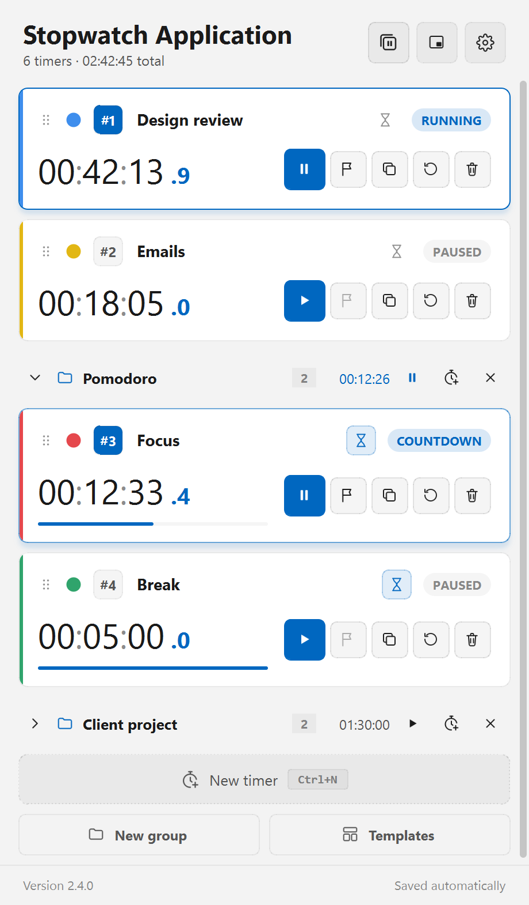
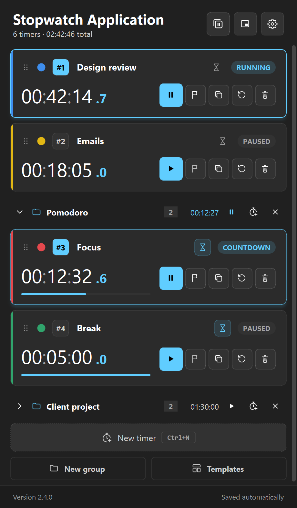
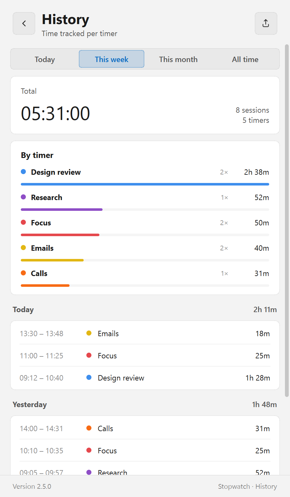
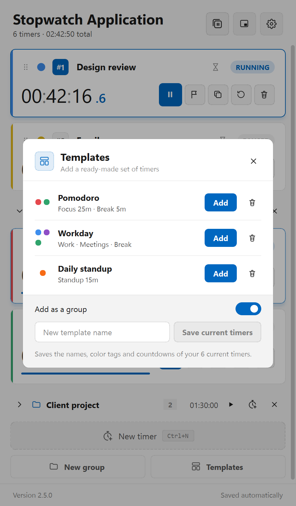
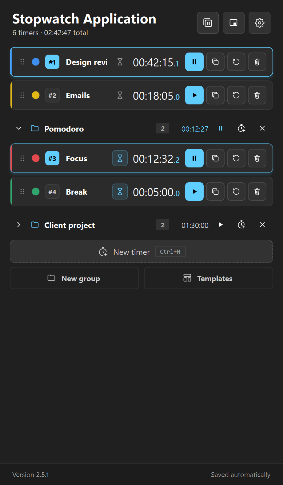
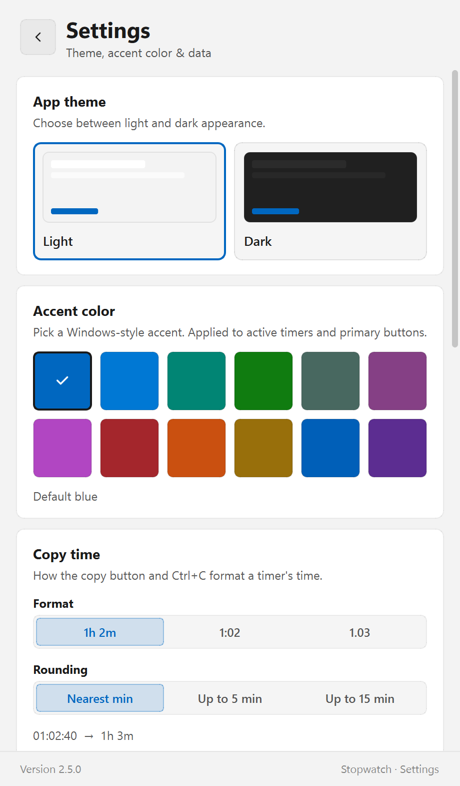
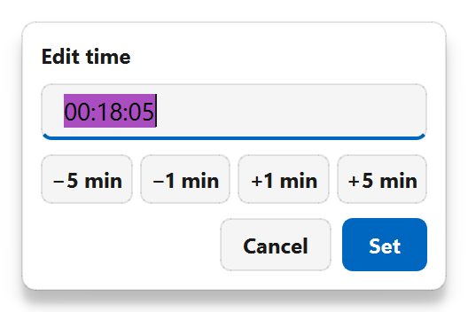
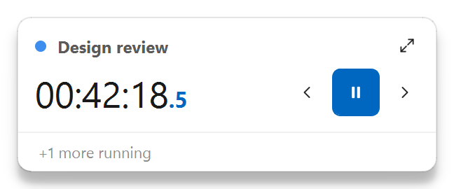

# Stopwatch Application

A multi-timer stopwatch for Windows 11. Run as many named timers as you need, organize them into groups,
see where your time went, and copy the result straight into a timesheet.

[](https://github.com/k-viktors/stopwatch-application/releases/latest/download/StopwatchApplicationSetup.exe)
&nbsp;
[](https://github.com/k-viktors/stopwatch-application/releases/latest)
&nbsp;
[](https://github.com/k-viktors/stopwatch-application/releases)

<p align="center">
  
  &nbsp;
  
</p>

## Features

- **Timers** — any number of named timers with start / pause, laps, reset and a color tag.
- **Countdown mode** — set a duration and the timer stops at zero.
- **Edit time** — click the digits to correct a timer you forgot to start (`1:20:00`, `45:00`, `1h 20m` or minutes).
- **Copy time** — one click copies the time as `1h 2m`, `1:02` or `1.03` hours, rounded to 1, 5 or 15 minutes.
- **Groups** — collapsible groups with their own total time and start/pause button.
- **Templates** — add a ready-made set of timers in one click: Pomodoro, Workday, Daily standup, or your own.
- **History** — every run is saved; see time per timer for today, this week, this month or all time, and copy it as CSV.
- **Mini window** — a small always-on-top bar with one timer.
- **Compact view, Always on top, Close to tray** — timers keep running in the background.
- **One timer at a time** — starting a timer pauses the others.
- **Start with Windows** and **global shortcuts** that work from any app.
- **Light and dark themes**, 12 Windows accent colors, drag to reorder, and Undo after deleting.
- **Automatic updates** — digitally signed, installed with one click.

What changed in each version: **[CHANGELOG.md](CHANGELOG.md)** (from 1.1.0 to today).

## Screenshots

| | | |
| :---: | :---: | :---: |
| <br>History | <br>Templates | <br>Compact view |
| <br>Settings | <br>Edit time | <br>Mini window |

## Install

1. **[Download the installer](https://github.com/k-viktors/stopwatch-application/releases/latest/download/StopwatchApplicationSetup.exe)**
   (`StopwatchApplicationSetup.exe`, always the latest version).
2. Run it and follow the steps. Windows asks for administrator approval.
3. Open **Stopwatch Application** from the Start menu.

Requires Windows 10 or 11 (64-bit). The installer isn't signed with a commercial certificate yet, so
Windows SmartScreen may ask once — choose **More info → Run anyway**.

<details>
<summary>Install from PowerShell instead</summary>

```powershell
irm https://github.com/k-viktors/stopwatch-application/releases/latest/download/install.ps1 | iex
```

The script downloads the latest version, checks its digital signature and checksum, and installs it.
</details>

## Keyboard shortcuts

| Keys | Action |
| --- | --- |
| `Space` | Start / pause the selected timer |
| `↑` `↓` | Select the previous / next timer |
| `Ctrl+N` or `N` | New timer |
| `Ctrl+C` | Copy the selected timer's time |
| `Delete` · `Ctrl+Z` | Delete the selected timer · undo |
| `Ctrl+Shift+Space` | Start / pause all timers |
| `Ctrl+Shift+Alt+Space` | Start / pause the last used timer — from any app |
| `Ctrl+Shift+Alt+P` | Pause all — from any app |
| `Ctrl+Shift+Alt+M` | Mini window — from any app |

## Your data

Timers, settings and history are stored only on your computer, in `%APPDATA%\Stopwatch Application`.
None of it is uploaded — the only thing the app downloads is the update check from this repository.
Uninstalling asks whether to keep or delete this data.

## Licenses

Stopwatch Application is free to download and use. It is built with
[Qt for Python (PySide6)](https://www.qt.io/qt-for-python) and Qt, used unmodified under the
[GNU LGPL v3](https://www.gnu.org/licenses/lgpl-3.0.html). The license texts and source links are
installed with the app in the `licenses` folder (`THIRD-PARTY-NOTICES.txt`).

## Updates and security

The app checks this repository's releases once a day (you can turn this off in Settings). Every release's
`latest.json` is signed with ECDSA P-256; the app and the install script refuse any update that isn't
signed with the developer's key, and verify the installer's SHA-256 before running it. The private key is
kept offline and is never part of this repository.
